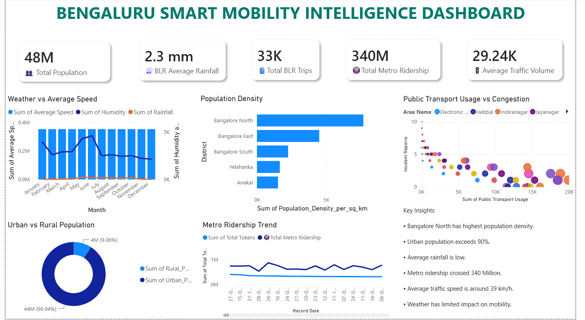
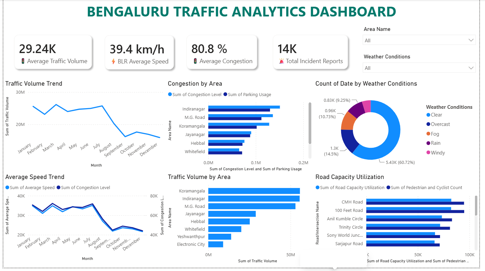
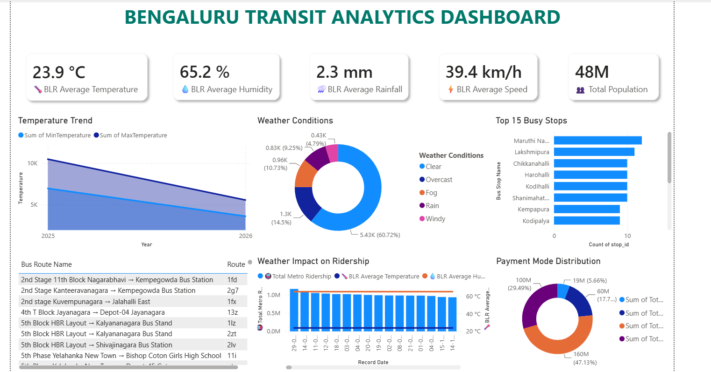
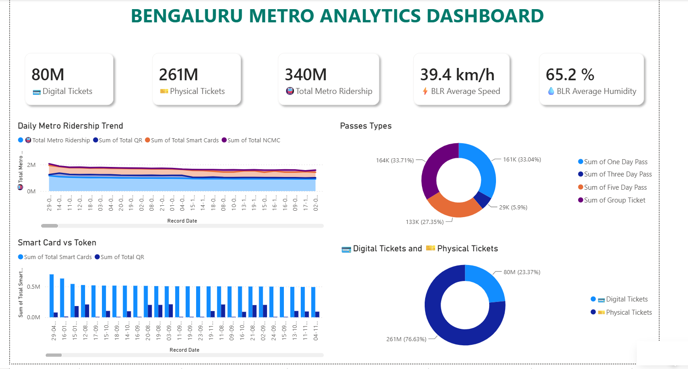
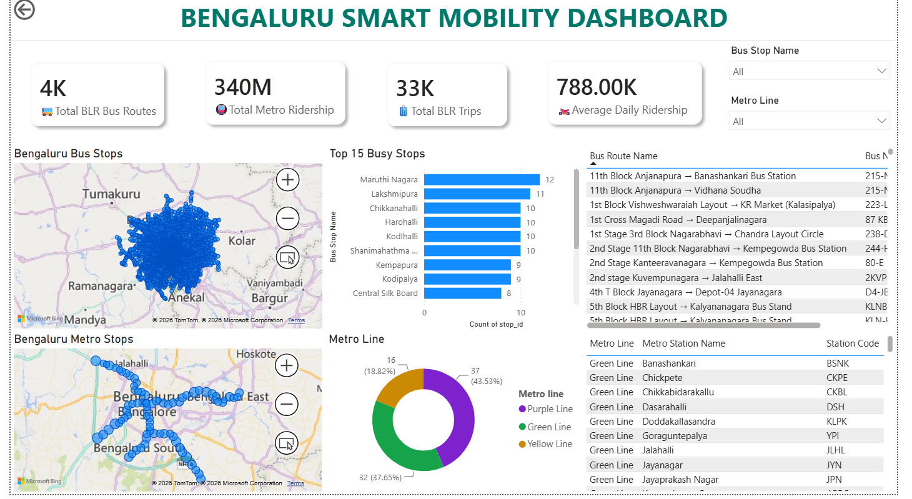
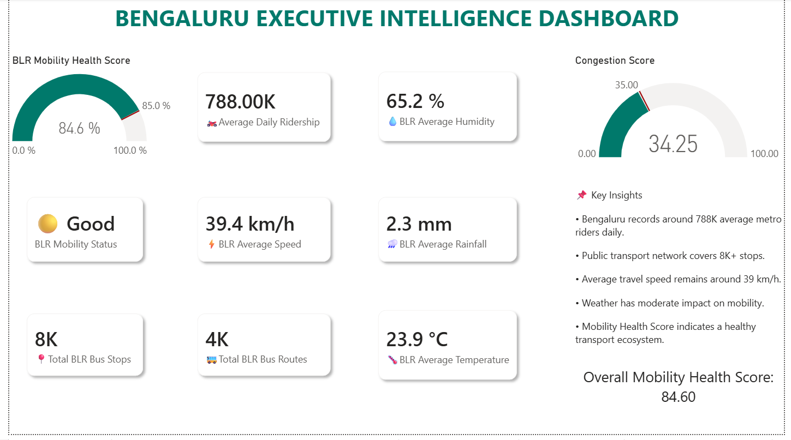
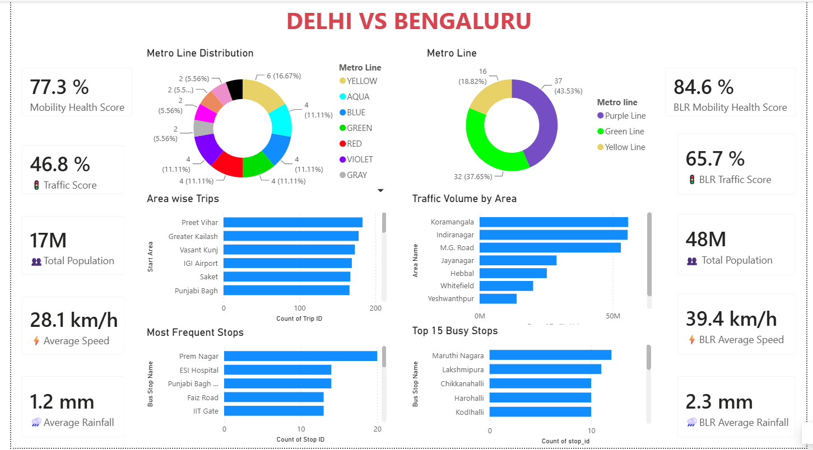

# Bengaluru Smart Mobility Intelligence Platform

### An end-to-end Power BI project analysing Bengaluru's buses, metro, traffic and weather

> A team project built during the **Infosys Springboard Virtual Internship 7.0**.
> This is my fork of the team repository: [Sameer-2904/Smart-City-Mobility-Intelligence-Platform](https://github.com/Sameer-2904/Smart-City-Mobility-Intelligence-Platform).



## Overview

This project combines Bengaluru's **bus GTFS, metro GTFS, metro ridership, traffic, weather and demographic data** into one set of interactive Power BI dashboards. City planners and transport teams can use it to see how the city moves, where it gets congested, and how weather and ticket types affect travel. A Delhi vs Bengaluru dashboard is included as a bonus comparison.

## Key numbers (Bengaluru)

| Metric | Value |
|---|---|
| Total metro ridership | **340M** |
| Average daily metro ridership | **788K** |
| Bus routes / bus stops / trips | **4K** / **8K** / **33K** |
| Average traffic speed | **39.4 km/h** |
| Average congestion / incident reports | **80.8%** / **14K** |
| Average temperature / humidity / rainfall | **23.9 °C** / **65.2%** / **2.3 mm** |
| **Mobility Health Score** | **84.6 (status: Good)** |

## Dashboards

### 1. Traffic Analytics
KPIs for traffic volume, speed, congestion and incident reports. Filters by area and weather condition. Includes traffic volume and speed trends, congestion by area, and road capacity utilisation.



### 2. Transit Analytics
Weather KPIs, temperature trend, weather conditions, the 15 busiest bus stops, bus route names, weather impact on metro ridership, and ticket payment mode distribution.



### 3. Metro Analytics
Digital vs physical tickets, daily ridership trend (QR, smart card, NCMC), smart card vs token usage, and pass types (one-day, three-day, five-day, group).



### 4. Smart Mobility (maps)
Interactive maps of Bengaluru's bus stops and metro stations, busiest stops, metro line split (Purple, Green, Yellow), and filters for bus stop and metro line.



### 5. Executive Intelligence
A one-page summary for decision makers: **Mobility Health Score**, congestion score, ridership, speed, weather KPIs and key insights.



### 6. Delhi vs Bengaluru
Side-by-side comparison of Mobility Health Score, traffic score, population, average speed, rainfall, metro lines and busiest stops.



## Key insights

- **Metro:** 340M total rides, about 788K per day. About **77% of tickets are physical** and **23% digital**.
- **Traffic hotspots:** Koramangala, Indiranagar and M.G. Road have the highest traffic volume and congestion.
- **Seasonal pattern:** Traffic volume and average speed both fall sharply after July.
- **Metro network:** The Purple Line has the most stations (43.5%), followed by Green (37.7%) and Yellow (18.8%).
- **City comparison:** Bengaluru scores **84.6** on Mobility Health vs **77.3** for Delhi, with a higher average speed (39.4 vs 28.1 km/h) in this dataset.

## Data pipeline

```
Raw datasets -> Power Query (cleaning) -> Schema standardisation -> Data modelling
-> Relationships -> DAX measures -> Power BI dashboards -> Executive insights
```

## Datasets

Bengaluru bus GTFS, Bengaluru metro GTFS, metro ridership, weather (Open-Meteo API), traffic, and demographics. Delhi data is used for the comparison dashboard. Files are in the `Bengaluru Data` and `Delhi Data` folders.

## Tech stack

| Area | Tools |
|---|---|
| BI and visuals | Microsoft Power BI |
| Calculations | DAX (including the Mobility Health Score) |
| Data cleaning | Power Query, Microsoft Excel |
| Data sources | GTFS transit data, Open-Meteo Weather API, CSV datasets |

## My contribution

> Edit this to match what you really did.

- Project Manager for a team of [N]: planned milestones, tracked progress and kept the documentation up to date.
- [Example: Cleaned and standardised the Bengaluru datasets in Power Query]
- [Example: Built the Bengaluru Executive Intelligence dashboard and the Mobility Health Score]

## How to open the dashboards

1. Download the `.pbix` file(s) from this repo.
2. Open them in the free **Power BI Desktop**.
3. If Power BI asks for data locations, point it to the `Bengaluru Data` and `Delhi Data` folders.

## Future enhancements

Real-time GTFS integration, live traffic APIs, IoT sensor data, predictive analytics, AI-based congestion forecasting, route optimisation and a mobile dashboard.

## Team

Built by a team during the Infosys Springboard Virtual Internship 7.0. Original repository: [Sameer-2904/Smart-City-Mobility-Intelligence-Platform](https://github.com/Sameer-2904/Smart-City-Mobility-Intelligence-Platform).

**Chandushree J B**, B.E. Artificial Intelligence & Machine Learning, Navkis College of Engineering, Hassan | [LinkedIn](https://www.linkedin.com/in/chandu-jb)
